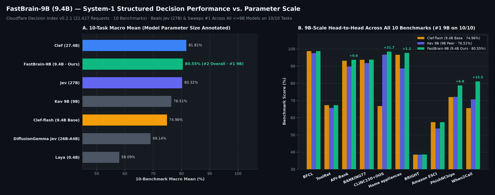
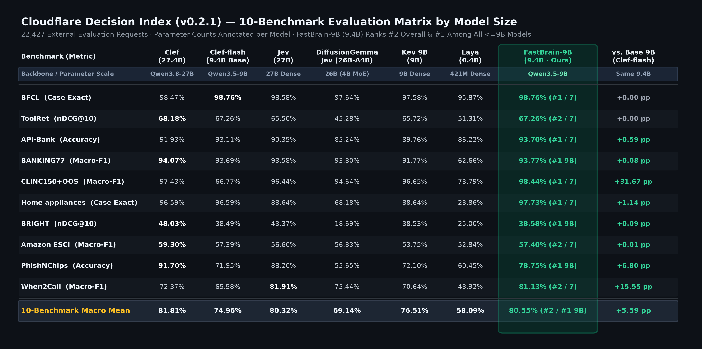
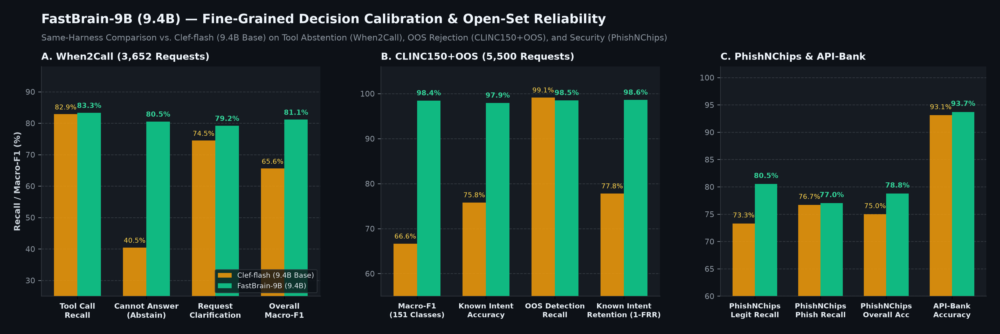

<div align="center">

# FastBrain-9B

**Non-Autoregressive System-1 Structured Decision Model**

[](https://huggingface.co/TypeScript/FastBrain-9B)
[](https://huggingface.co/datasets/TypeScript/FastBrain-Instruct)
[-10b981?style=flat-square)](#benchmark-evaluation)
[](./LICENSE)

</div>

---

## Overview

**FastBrain-9B** is a single-forward-pass, non-autoregressive **System-1 structured decision model** built on a hybrid `Qwen3.5-9B` backbone (`24` Gated DeltaNet linear-attention blocks + `8` full-attention blocks) coupled with a `116M`-parameter `JointSchemaHead`.

Given an arbitrary JSON state and one or more structured decision questions (`choice` multiple-choice, `noul` binary verification, or `score` multi-candidate ranking), **FastBrain-9B** evaluates all candidate options and questions **jointly in a single prefill pass (`0` generated tokens)**—delivering calibrated option probabilities, tool-call selections, and open-set abstention decisions at encoder-level latency.

- **Model Weights**: [`TypeScript/FastBrain-9B`](https://huggingface.co/TypeScript/FastBrain-9B) (Full `9B` backbone with all `104` adapted projection layers merged in-place + `joint_head.safetensors`, zero external LoRA/PEFT dependencies)
- **Training Dataset**: [`TypeScript/FastBrain-Instruct`](https://huggingface.co/datasets/TypeScript/FastBrain-Instruct) (`108,278` strictly decontaminated structured decision instances)

---

## Benchmark Evaluation & Parameter Scale Comparison

Evaluated on the official **Cloudflare Decision Index (v0.2.1)** across **10 benchmarks (22,427 evaluation requests)**, **FastBrain-9B (`9.4B`)** achieves an overall Macro Mean of **`80.55%`**:
- **Ranks `#1` across all `<=9B` models on `10 / 10` benchmarks**, outperforming the same-size base model `Clef-flash` (`9.4B`, `74.96%`) by **`+5.59 pp`**, `Kev 9B` (`9B`, `76.51%`) by **`+4.04 pp`**, and `Laya` (`0.4B`, `58.09%`) by **`+22.46 pp`**.
- **Outperforms `3x`-larger `27B`-class models**: surpasses `Jev` (`27B`, `80.32%`) and `DiffusionGemma Jev` (`26B-A4B`, `69.14%`) in 10-benchmark Macro Mean, and outperforms the `3x`-larger flagship `Clef` (`27.4B`, `81.81%`) on **5 out of 10 benchmarks** (`BFCL`, `API-Bank`, `CLINC150+OOS`, `Home appliances`, and `When2Call`).



### Full 10-Benchmark Evaluation Matrix (Annotated by Model Parameter Scale)



### Fine-Grained Decision Calibration & Open-Set Reliability



| Benchmark | Metric | `Laya`<br>*(0.4B / 421M)* | `DiffusionGemma Jev`<br>*(26B-A4B · 4B Act)* | `Clef-flash`<br>*(9.4B Base)* | `Kev 9B`<br>*(9B Dense)* | `Jev`<br>*(27B Dense)* | `Clef`<br>*(27.4B Flagship)* | **FastBrain-9B**<br>*(9.4B · Ours)* |
| :--- | :--- | :---: | :---: | :---: | :---: | :---: | :---: | :---: |
| **Parameter Scale** | **Total (Active)** | `0.42B` | `25.8B (4B MoE)` | `9.41B` | `9.0B` | `27.0B` | `27.36B` | **`9.41B`** |
| **BFCL** | Case Exact | 95.87% | 97.64% | 98.76% | 97.58% | 98.58% | 98.47% | **98.76% (#1)** |
| **ToolRet** | nDCG@10 | 51.31% | 45.28% | 67.26% | 65.72% | 65.50% | 68.18% | **67.26% (#2 · #1 9B)** |
| **API-Bank** | Accuracy | 86.22% | 85.24% | 93.11% | 89.76% | 90.35% | 91.93% | **93.70% (#1)** |
| **BANKING77** | Macro-F1 | 62.66% | 93.80% | 93.69% | 91.77% | 93.58% | 94.07% | **93.77% (#1 9B)** |
| **CLINC150+OOS** | Macro-F1 | 73.79% | 94.64% | 66.77% | 96.65% | 96.44% | 97.43% | **98.44% (#1)** |
| **Home appliances** | Case Exact | 23.86% | 68.18% | 96.59% | 88.64% | 88.64% | 96.59% | **97.73% (#1)** |
| **BRIGHT** | nDCG@10 | 25.00% | 18.69% | 38.49% | 38.53% | 43.37% | 48.03% | **38.58% (#1 9B)** |
| **Amazon ESCI** | Macro-F1 | 52.84% | 56.83% | 57.39% | 53.75% | 56.60% | 59.30% | **57.40% (#2 · #1 9B)** |
| **PhishNChips** | Accuracy | 60.45% | 55.65% | 71.95% | 72.10% | 88.20% | 91.70% | **78.75% (#1 9B)** |
| **When2Call** | Macro-F1 | 48.92% | 75.44% | 65.58% | 70.64% | 81.91% | 72.37% | **81.13% (#2 · #1 9B)** |
| **Macro Mean (10)** | **Average** | **58.09%** | **69.14%** | **74.96%** | **76.51%** | **80.32%** | **81.81%** | **80.55% (#2 · #1 9B)** |

---

## Installation

```bash
git clone https://github.com/camera-2018/FastBrain.git
cd FastBrain
pip install -e .
```

---

## Quickstart

### 1. PyTorch / Transformers (`bfloat16` or `4-bit` / `8-bit` Quantized on Colab T4)

```python
import torch
from fastbrain import load_release_model, systemone

# Full precision (24GB+ GPU: L4, A100, RTX 3090/4090, RTX PRO 6000):
model, processor = load_release_model("TypeScript/FastBrain-9B", device="cuda", dtype=torch.bfloat16)

# Or 4-bit NF4 mixed-precision (~6.8 GB VRAM on a free Google Colab T4 16GB GPU):
# model, processor = load_release_model("TypeScript/FastBrain-9B", device="cuda", dtype=torch.float16, load_in_4bit=True)

response = systemone(model, processor, {
    "model": "TypeScript/FastBrain-9B",
    "state": {
        "query": "Can you check my account balance?",
        "tools": ["get_balance", "transfer_funds"],
    },
    "questions": {
        "q": {
            "type": "choice",
            "query": "Select the best next action.",
            "criteria": {
                "a": "Call <tool_call>{\"name\": \"get_balance\", \"arguments\": {}}</tool_call>",
                "b": "Could you please provide your account ID or authentication token first?",
                "c": "I am unable to access personal banking records.",
            },
        },
    },
})
print(response)
```

### 2. `llama.cpp` GGUF (`Q4_K_M` / `Q8_0` / `BF16`) via `/v1/systemone`

`TypeScript/FastBrain-9B` provides pre-quantized `llama.cpp` (`b11430`+ `ClefModel`) GGUF weights where the `116M` `JointSchemaHead` (`dec.*`) and Gated DeltaNet states (`ssm_`) are preserved at `Q8_0` precision:

```bash
# Serve the 6.04 GB Q4_K_M GGUF via llama-server on the /v1/systemone endpoint
llama-server -hf TypeScript/FastBrain-9B:Q4_K_M --port 8080

# Query /v1/systemone in a single forward pass
curl http://127.0.0.1:8080/v1/systemone \
  -H "Content-Type: application/json" \
  -d '{
    "model": "FastBrain-9B",
    "state": "Customer message: I was charged twice for my order last week and nobody has replied.",
    "questions": {
      "route": {
        "type": "choice",
        "instructions": "Which team should handle this?",
        "criteria": {"billing": "Payments or invoices", "technical": "Bugs or outages"}
      },
      "urgent": {"type": "noul", "instructions": "Is the customer requesting urgent resolution?"}
    }
  }'
```

| Format / Precision Tier | Weight Footprint | Peak VRAM | Minimum Hardware | Typical Latency (`500–1k tok`) |
| :--- | :---: | :---: | :--- | :---: |
| **`FastBrain-9B-Q4_K_M.gguf`** *(4-bit + `Q8_0` Head)* | `6.04 GB` | `~7.2 GB` | **8GB GPU / Colab Free T4 (16GB) / Mac M1–M4** | `~90–220 ms` |
| **PyTorch `load_in_4bit=True`** *(NF4 + `fp16` Head)* | `~5.5 GB` | `~6.8 GB` | **Colab Free T4 (16GB) / RTX 3060–4060 (8GB+)** | `~180–280 ms` |
| **`FastBrain-9B-Q8_0.gguf`** *(Full 8-bit GGUF)* | `9.68 GB` | `~11.0 GB` | **12GB–16GB GPU / Colab T4 / Mac 16GB+** | `~80–180 ms` |
| **PyTorch `load_in_8bit=True`** *(INT8 + `bf16` Head)* | `~9.6 GB` | `~11.2 GB` | **Colab T4 (16GB) / RTX 4070 Ti (12GB+)** | `~130–210 ms` |
| **Native `bfloat16` (`safetensors` / `BF16.gguf`)** | `18.82 GB` (`18.16 GB`) | `20.3–24.7 GB` | **Colab L4 (24GB) / RTX 3090–4090 / PRO 6000 (96GB)** | **`38.8 ms` (`B=1`) · `61.7 ms` (`B=16` on G4 6000)** |

---

## Repository Structure

```text
FastBrain/
├── assets/                            # Benchmark figures & CSV evaluation summaries
├── fastbrain/                         # Core model, JointSchemaHead & calibration runtime
│   ├── __init__.py
│   ├── modeling_fastbrain.py          # ClefModel, JointSchemaHead, load_release_model, systemone
│   ├── calibration.py                 # Compile-time AST schema topology & margin calibration
│   └── joint_head_config.json         # 116M JointSchemaHead configuration
├── train/                             # Joint training & in-place 9B weight merging
│   ├── train_joint_schema.py          # Calibrated Cross-Entropy + Brier + Margin loss training
│   └── merge_lora_into_9b.py          # In-place 104-layer LoRA + 122-tensor head merger
├── eval/                              # Official Decision Index (v0.2.1) evaluation & plotting
│   ├── run_decision_index_eval.py     # Full 22,427-request evaluation runner
│   └── plot_benchmarks.py             # Reproducible technical figure generator
└── examples/                          # End-to-end inference examples
    ├── quickstart_tool_calling.py
    ├── open_set_intent_oos.py
    └── security_verdict_noul.py
```

---

## License

Released under the [Apache-2.0 License](./LICENSE).
